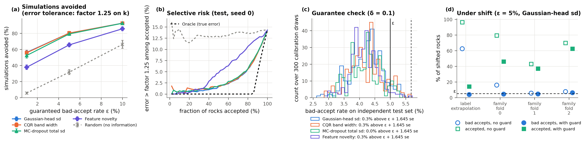

<div align="center">

# Conformal uncertainty for digital rock

**Calibrated prediction intervals and risk-controlled simulation triage for deep-learning prediction of pore-scale properties from micro-CT images**

[](https://github.com/gulzara3/conformal-digital-rock/actions/workflows/ci.yml)
[](https://colab.research.google.com/github/gulzara3/conformal-digital-rock/blob/main/notebooks/conformal_digital_rock.ipynb)
[](LICENSE)
[](pyproject.toml)
[](CHANGELOG.md)
<!-- After the Zenodo deposit, replace with: [](https://doi.org/10.5281/zenodo.XXXXXXX) -->

</div>

This repository holds the code, data pipeline, trained-model outputs and every table and figure of

> G. Alam and S. Khan. *Conformal uncertainty quantification and risk-controlled simulation triage for deep-learning prediction of pore-scale properties from micro-CT images.* Submitted to *Artificial Intelligence in Geosciences* (revised and extended version of AIIG-D-26-00274).

A 3D residual network predicts six pore-network properties of 14,174 DeePore rock volumes. We test four conformal predictors against heuristic uncertainty estimates over ten independent training seeds and splits, verify the implementation against the exact finite-sample law, give joint coverage across properties, study three kinds of distribution shift, and turn calibrated uncertainty into a guaranteed accept-or-simulate decision.

<p align="center"></p>

## Key results

| Result | Value | Source |
|---|---|---|
| Mean coverage error at a 90% target, four conformal predictors | 0.52 to 0.73 points | `T07`, Table 3 |
| Same for Gaussian head, MC-dropout and deep ensemble | 7.3 to 20.1 points | `T07`, Table 3 |
| Exact-law tests rejected after Bonferroni correction | 0 of 48 | `T15`, Table S13 |
| Joint coverage of all six properties: independent intervals vs max-score box | 63.7% vs 90.0% | `T23`, Table 4 |
| Simulations avoided at a guaranteed 1% rate of predictions off by more than 25% | 56% (random rule: 6%) | `T27`, Table 7 |
| False-alarm rate of the label-free guard (target 5%) | 4.8% to 6.0% | `T25`, Table 6 |

Every number above is recomputed from the released predictions by `scripts/reproduce_tables.py`, which matches the released tables to machine precision.

## What is in this repository

| Item | Where | Notes |
|---|---|---|
| Build script for the dataset from the public Zenodo archive | [`scripts/prepare_deepore.py`](scripts/prepare_deepore.py) | MD5 check, DeePore outlier rules, phase check, two-channel 64³ coarse-graining |
| Full experiment, Google Colab (L4 GPU) | [`notebooks/conformal_digital_rock.ipynb`](notebooks/conformal_digital_rock.ipynb) | Trains all 30 networks and writes every table and figure; resumes after disconnects |
| Python package | [`src/conformal_rock`](src/conformal_rock) | Conformal predictors, exact law, joint box, guard, weighted conformal, Learn-then-Test, network, data pipeline |
| Command-line training of one run | [`scripts/train.py`](scripts/train.py) | Same settings as the notebook; reuses the released split |
| Recompute headline tables from predictions | [`scripts/reproduce_tables.py`](scripts/reproduce_tables.py) | CPU only, under a minute |
| Apply a trained network to your own volumes | [`scripts/predict_external.py`](scripts/predict_external.py) | Intervals, guard p-values and accept/simulate decisions |
| All tables (CSV) and figures (PNG, PDF) | [`results/tables`](results/tables), [`results/figures`](results/figures) | Mapping to paper numbers in [`docs/RESULTS.md`](docs/RESULTS.md) |
| Split indices of all 30 runs | [`results/splits`](results/splits) | Rows of the working dataset and their DeePore `h5_index` |
| Retained DeePore indices, exclusion counts, connectivity check | [`results/data`](results/data) | |
| Configuration, software versions, one log per network | [`results/logs`](results/logs) | Includes the frozen `pip freeze` of the Colab run |
| SHA-256 manifest of every released file | [`results/MANIFEST.json`](results/MANIFEST.json) | Checked by [`scripts/verify_release.py`](scripts/verify_release.py) and by CI |
| Predictions of all 30 runs (185 MB) | GitHub release asset and Zenodo | Fetched by [`scripts/fetch_release.py`](scripts/fetch_release.py) |
| Trained checkpoints (30 networks, 509 MB) | GitHub release asset and Zenodo | Checksums in [`checkpoints/SHA256SUMS`](checkpoints/SHA256SUMS) |

## Quick start

```bash
git clone https://github.com/gulzara3/conformal-digital-rock.git
cd conformal-digital-rock
python -m venv .venv && source .venv/bin/activate      # Windows: .venv\Scripts\activate
pip install -e ".[dev]"

pytest                                   # unit and statistical tests, plus manifest check (about 10 s)
python scripts/verify_release.py         # every released table, figure, split and log against its SHA-256
python scripts/fetch_release.py          # downloads the predictions of all 30 runs (185 MB)
python scripts/reproduce_tables.py       # recomputes Tables 3, 4, 7, S7 and S24 and compares them
```

Expected output of the last command:

```
  PASS  T06 coverage and width                42 rows compared, largest difference 1.11e-16
  PASS  T07 coverage errors (Table 3)          7 rows compared, largest difference 3.55e-15
  PASS  T23 joint coverage (Table 4)           8 rows compared, largest difference 1.11e-16
  PASS  T27 triage (Table 7, Table S24)       60 rows compared, largest difference 1.11e-16
ALL PASS
```

## Using the conformal tools on your own model

```python
import numpy as np
from conformal_rock import conformal as C, triage as T
from conformal_rock.shift import conformal_pvalue

# cal / te: dicts with arrays "y" and "mu" of shape (n, P); add "sig" (n, P) for normalized conformal
# and "q" (n, P, 10) for CQR. tr: the same for training volumes.
lo, hi, _ = C.interval("norm", cal, te, j=0, alpha=0.1, tr=tr)        # 90% interval for property 0
print("coverage", C.coverage(te["y"][:, 0], lo, hi))

# joint 90% box over several properties (max-score construction)
lo, hi, q = C.joint_box(cal, te, props=[0, 1], alpha=0.1, scale_cal=train_residual_sd[[0, 1]])

# accept-or-simulate: bad accept = error larger than a factor 1.25 on permeability
bad = T.bad_accept_labels(cal["mu"][:, 0], cal["y"][:, 0], tol_factor=1.25)
t = T.ltt_threshold(cal["sig"][:, 0], bad, eps=0.01, delta=0.1, grid=T.threshold_grid(monitor_sig))
accept = te["sig"][:, 0] <= t
```

## Reproducing the full study

1. **Colab (recommended).** Open the notebook with the badge above, choose an L4 GPU and run all cells. The notebook downloads `DeePore_Dataset.h5` from [Zenodo record 4297035](https://zenodo.org/records/4297035), verifies its MD5 checksum, and caches every stage to Google Drive. Preprocessing takes about 30 minutes and training all 30 networks about 2.9 hours.
2. **Command line.** `python scripts/prepare_deepore.py` builds the working dataset, and `python scripts/train.py --run main_s0` retrains one network on its released split.

Details, run times and the exact correspondence between scripts and paper sections are in [`docs/REPRODUCIBILITY.md`](docs/REPRODUCIBILITY.md). The data pipeline is documented in [`docs/DATA.md`](docs/DATA.md), and the methods in [`docs/METHODS.md`](docs/METHODS.md).

## Repository layout

```
conformal-digital-rock/
├── src/conformal_rock/       Python package (conformal, shift, triage, data, model, io, metrics, config)
├── scripts/                  prepare_deepore, train, reproduce_tables, verify_release, fetch_release, predict_external
├── notebooks/                Colab notebook that produced every result
├── results/
│   ├── tables/               T01 to T32 as CSV, plus key_numbers.json
│   ├── figures/              F01 to F16 as PNG and PDF
│   ├── splits/               split indices of all 30 runs
│   ├── data/                 retained DeePore indices, exclusions, connectivity, preprocessing metadata
│   ├── logs/                 config, environment, frozen requirements, one log per network
│   └── MANIFEST.json         SHA-256 of every file of the release, including predictions and checkpoints
├── checkpoints/              checksums and download instructions for the 30 trained networks
├── docs/                     data, methods, reproducibility, results map, reviewer-comment map
├── paper/                    how the paper's tables and figures map to this repository
└── tests/                    pytest suite (statistical tests of the guarantees, model, data, release)
```

## Scope of the guarantees

All coverage statements refer to DeePore's pore-network reference labels, not to laboratory measurements, and they assume calibration and deployment rocks are exchangeable. Under distribution shift every method loses coverage (Section 5.7 of the paper). The label-free guard flags unfamiliar rocks, and calibration on rocks from the target formation is needed for a formal guarantee on new rocks.

## Citation

If you use this code or the released results, please cite the paper and the DeePore dataset. A machine-readable entry is in [`CITATION.cff`](CITATION.cff).

```bibtex
@misc{alam2026conformalrock,
  author = {Alam, Gulzar and Khan, Sikandar},
  title  = {Conformal uncertainty quantification and risk-controlled simulation triage for
            deep-learning prediction of pore-scale properties from micro-CT images},
  year   = {2026},
  note   = {Code and data: https://github.com/gulzara3/conformal-digital-rock, release v2.0.0}
}

@article{rabbani2020deepore,
  author  = {Rabbani, Arash and Babaei, Masoud and Shams, Reza and Wang, Ying Da and Chung, Traiwit},
  title   = {DeePore: A deep learning workflow for rapid and comprehensive characterization of porous materials},
  journal = {Advances in Water Resources},
  volume  = {146},
  pages   = {103787},
  year    = {2020},
  doi     = {10.1016/j.advwatres.2020.103787}
}
```

## License

Code is released under the [MIT License](LICENSE). The DeePore dataset is distributed by its authors through Zenodo under its own terms; this repository does not redistribute the volumes. See [`docs/DATA.md`](docs/DATA.md).

## Contact

Sikandar Khan (corresponding author), King Fahd University of Petroleum & Minerals, sikandarkhan@kfupm.edu.sa. Questions and bug reports are welcome as [GitHub issues](https://github.com/gulzara3/conformal-digital-rock/issues).
